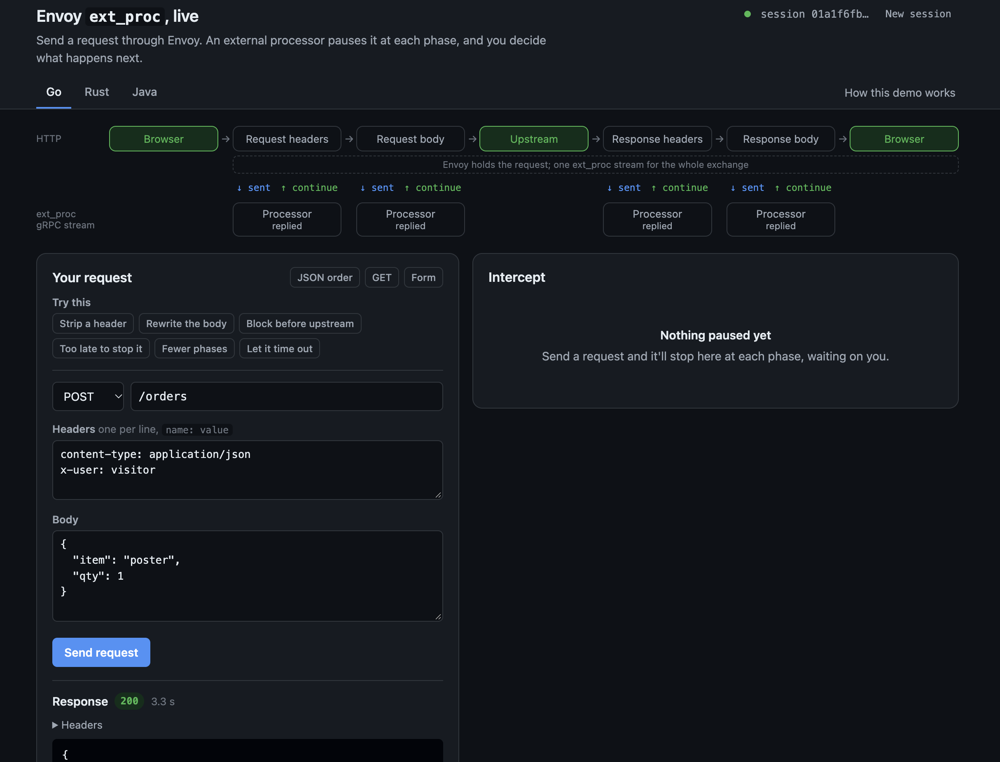

# envoy-extproc-sdk-site

Interactive demo site for Envoy External Processing (`ext_proc`) SDKs across **Go**, **Rust**, and **Java**. Send HTTP requests through Envoy, pause at each `ext_proc` phase, inspect or mutate headers and bodies in the browser, and choose whether to **Continue** or **Cancel** (short-circuit with an immediate response).

Try it at https://envoy-extproc-sdk.com/ (or [.org](https://envoy-extproc-sdk.org/), [.dev](https://envoy-extproc-sdk.dev/), [.app](https://envoy-extproc-sdk.app/))



## Links

* Envoy external processing: https://www.envoyproxy.io/docs/envoy/latest/configuration/http/http_filters/ext_proc_filter
* Go SDK: https://github.com/wrossmorrow/envoy-extproc-sdk-go
* Rust SDK: https://github.com/wrossmorrow/envoy-extproc-sdk-rust
* Java SDK: https://github.com/wrossmorrow/envoy-extproc-sdk-java

## Architecture

Envoy acts as the single front door (port `8000` inside Compose, `8081` on localhost), sitting in front of an internal Docker network (`demo`):

```
Browser / Client
   │
   ▼
Envoy (:8000 / :8081)
   ├── GET / (text/html), /style.css, /app.js  ──▶ web (:8000)                [ext_proc disabled]
   ├── /controller.v1.DemoControllerService/*  ──▶ controller (:9092, Connect) [ext_proc disabled]
   └── API requests                            ──▶ ext_proc ──▶ upstream (echo :8000)
          │                                            ▲
          ├─ x-demo-target-lang: go (default) ─────────┼── extproc (:50051, Go)
          ├─ x-demo-target-lang: rust ─────────────────┼── extproc-rust (:50051, Rust)
          └─ x-demo-target-lang: java ─────────────────┴── extproc-java (:50051, Java)
                                                               │
                                               DemoProcessorService.Process (gRPC bidi :9093)
                                                               ▼
                                                        controller (:9093)
```

- **`web`** (`cmd/web`, `web/static/`): Serves the static frontend (`index.html`, `style.css`, `app.js`).
- **`controller`** (`cmd/controller`, `internal/controller/`): Owns interactive session state (`SessionTTL = 10m`, `PhaseTimeout = 30s`), streams phase snapshots to the browser via Connect `CreateSession`, accepts human decisions via `SubmitDecision`, and coordinates with the `extproc` services over `DemoProcessorService.Process` (`:9093`).
- **`extproc` / `extproc-rust` / `extproc-java`**: Three equivalent `RequestProcessor` implementations built on:
  - [`envoy-extproc-sdk-go`](https://github.com/wrossmorrow/envoy-extproc-sdk-go) (`internal/extproc/`, `cmd/extproc/`)
  - [`envoy-extproc-sdk-rs`](https://github.com/wrossmorrow/envoy-extproc-sdk-rs) (`rust/demo-extproc/`)
  - [`envoy-extproc-sdk-java`](https://github.com/wrossmorrow/envoy-extproc-sdk-java) (`java/demo-extproc/`)
- **`upstream`**: `simple-echo-server` echoing the received method, path, headers, and body.
- **Session validation**: Requests missing `x-demo-session-id` receive an immediate `400`; unknown/expired session IDs receive `404`.
- **Protections**: Envoy applies `local_ratelimit`, `global_downstream_max_connections`, and a `65536`-byte `per_connection_buffer_limit_bytes` cap.

## Repository Layout

- `proto/controller/v1/controller.proto` — Shared `DemoControllerService` & `DemoProcessorService` contracts.
- `gen/{go,rust,java}/` — Generated protobuf/gRPC/Connect code (`just gen` via `buf generate`; do not edit by hand).
- `envoy.yaml` — Envoy listener, routing, `ext_proc`, rate limiting, and access-log configuration.
- `compose.yaml` & `compose.prod.yaml` — Local Compose stack and production ECR override.
- `infra/terraform/` — AWS deployment (Route 53 + ACM multi-SAN TLS + NLB + EC2 + SSM/ECR IAM).

## Running Locally

### Prerequisites

- Docker & Docker Compose
- [`just`](https://github.com/casey/just) (optional, wraps common commands)
- For building `extproc-java`: GitHub Packages credentials (`gpr.user` / `gpr.key` in `~/.gradle/gradle.properties`, or `GITHUB_ACTOR` / `GITHUB_TOKEN` env vars) to pull `com.github.wrossmorrow:extproc`.

### Start the Stack

```bash
just up
# or: docker compose up --build
```

Open **`http://localhost:8081/`** in your browser.

To tear down:

```bash
just down
```

### Direct API Calls

Requests without a valid `x-demo-session-id` header return `400` (missing) or `404` (unknown session). With an active session ID from the UI (or `DemoControllerService/CreateSession`), you can send requests straight to Envoy on `:8081`:

```bash
curl -i http://localhost:8081/orders \
  -H 'x-demo-session-id: <session-id>' \
  -H 'x-demo-target-lang: go' \
  -H 'content-type: application/json' \
  -d '{"item":"poster","qty":1}'
```

## Development & Testing

```bash
# Regenerate Go, Rust, and Java protobuf/gRPC stubs
just gen

# Go tests & lint
just test
just lint

# Rust tests & lint
just rust-test
just rust-lint

# Java tests
just java-test
```

## Deploying to AWS (Terraform + ECR)

`infra/terraform/` provisions:
- A multi-SAN **ACM** certificate with **Route 53** DNS validation and `A` alias records for your configured domains.
- A public **Network Load Balancer** (`TLS:443` → `TCP:8000`).
- An **Amazon Linux 2023** EC2 instance (`t3.medium` by default) running `compose.yaml` + `compose.prod.yaml` via systemd (`extproc-demo.service`), locked down to port `8000` from the NLB only (access via SSM Session Manager).

1. Build and push images to ECR (update `ecr_registry` / `ecr_repo_prefix` in `justfile` as needed):
   ```bash
   just publish
   ```
2. Configure Terraform variables and apply:
   ```bash
   cp infra/terraform/terraform.tfvars.example infra/terraform/terraform.tfvars
   # edit terraform.tfvars with your domains and ECR registry
   terraform -chdir=infra/terraform init
   terraform -chdir=infra/terraform apply
   ```
3. To update a running instance with newly pushed images with minimal downtime:
   ```bash
   cd /opt/extproc-demo
   aws ecr get-login-password --region <region> | docker login --username AWS --password-stdin <ecr_registry>
   docker compose -f compose.yaml -f compose.prod.yaml pull
   docker compose -f compose.yaml -f compose.prod.yaml up -d --remove-orphans
   ```
